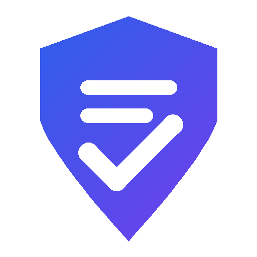

# Spec Guard



**Keep Jira work items, the code your AI agents write, and your Confluence specs in sync — before drift ships.**

Spec Guard is an Atlassian Forge app (Jira + Confluence) built for Codegeist 2026. It treats the Confluence specification as the source of truth and continuously checks it against the Jira work items that implement it — and against the changes coding agents make, through MCP.

## The problem

Specs and tickets drift apart. A PM tightens a requirement in Confluence; the Jira ticket still says the old value; a developer — or, increasingly, an AI coding agent — builds from the ticket. The mismatch is found in QA, in review, or in production.

## What Spec Guard does

| Where | What you get |
|---|---|
| **Jira work item** (sidebar + panel) | An alignment report: every requirement in the linked spec that is in this work item's scope, marked **covered / missing / conflict / unclear / delivered by another work item**, with verbatim quotes from both the spec and the work item. Open questions to clarify before coding. |
| **Jira work item → Align work item with spec** | One click proposes corrected acceptance criteria (exact spec values, in-scope only, each tagged with its spec id). You preview the changes; on *Apply* the work item's acceptance criteria section is rewritten — the rest of the description is kept — and an audit comment is added. |
| **Jira work item → Verify a change** | Paste a summary or diff of what was implemented. Spec Guard says **pass / needs attention / fails spec**, with findings, spec quotes and concrete fixes — and separately lists where the work item itself disagrees with the spec. |
| **Confluence spec page** (byline) | Which work items implement this spec and which drift, plus a **requirement coverage map**: every requirement → the work items that deliver it, and the **gaps** no work item covers — then **create work items for the gaps** in one click (linked to the spec, quoting the requirement, never duplicated). |
| **Spec changes** | When a spec page is edited, every linked work item gets a comment with the before/after of the changed requirements and their impact, and its report is flagged *re-check needed*. |
| **Jira global page** | One table of all checked work items, conflicts first — plus **Try with demo data**: one click creates a spec page and three drifting work items, so you can try Spec Guard on an empty site in under a minute. |
| **Rovo agent** | "Is this work item aligned with its spec?", "What does the spec require?", "Check my implementation", "Which requirements are not covered?", "Fix this work item", "Create tickets for the gaps". |
| **MCP tools** (Claude Code, Cursor, …) | `get-spec-context` (call before coding), `verify-change` (call after coding), `check-alignment`, `get-alignment-status`, `get-spec-coverage`, `align-work-item`, `create-gap-work-items`. Coding agents get the real requirements, not a stale ticket — and can close the loop themselves. |

## How it works

- **Forge UI Kit** modules: `jira:issuePanel`, `jira:issueContext`, `jira:globalPage`, `confluence:contentBylineItem`.
- **Forge LLM** (Atlassian-hosted Claude) does the analysis — no data leaves Atlassian. The app is eligible for **Runs on Atlassian**.
- **Rovo**: `rovo:agent` + `action` modules; the same actions are exposed through **`rovo:mcp`**.
- **Async work** (analysis, coverage maps, change verification, spec-change notifications) runs on a Forge **events queue**, with **offline user impersonation**: each job runs with the permissions of the user who started it.
- **Forge KVS** stores analyses, page snapshots (for before/after diffs) and the spec ↔ work item index.
- **Product event trigger** `avi:confluence:updated:page` drives spec-change notifications; an hourly **scheduled trigger** re-checks watched specs as a fallback in case an event is not delivered.

### Transparency and permissions

- Every finding cites the spec verbatim, so a human can check the model's reasoning.
- All reads use the current user's permissions (`asUser`). A user who cannot read a spec page never sees analyses or quotes derived from it — in the panel, the dashboard, Rovo or MCP.

## Install (judges)

1. Open the **[installation link](https://developer.atlassian.com/console/install/00236d0b-a8f0-4b50-82c2-f1d2d34642cc?signature=AYABeANXnkRj8HTUktLBcipDCiMAAAADAAdhd3Mta21zAEthcm46YXdzOmttczp1cy13ZXN0LTI6NzA5NTg3ODM1MjQzOmtleS83MDVlZDY3MC1mNTdjLTQxYjUtOWY5Yi1lM2YyZGNjMTQ2ZTcAuAECAQB4CxqLTo9l4lqXuFjNim1xJM%2Bp%2F3TVP9xHS2BrU5DRRucB5R7YMDOdYQ2qI8zw%2BemziAAAAH4wfAYJKoZIhvcNAQcGoG8wbQIBADBoBgkqhkiG9w0BBwEwHgYJYIZIAWUDBAEuMBEEDIfsHqTrZqFxohTPugIBEIA7bizlk2Qdd0QT%2BV1mWdRnlwi2XODKze6VP7WW2FxGnY47pQcZarof5zdfwBXbv1wJfCZQRU8n5o85GQYAB2F3cy1rbXMAS2Fybjphd3M6a21zOmV1LXdlc3QtMTo3MDk1ODc4MzUyNDM6a2V5LzQ2MzBjZTZiLTAwYzMtNGRlMi04NzdiLTYyN2UyMDYwZTVjYwC4AQICAHi9bVMAkme4qVQX1fQHo6ePw3H40A7cGfz7yrmSfBWMXgFLc99DspU4OhiaWHU6POCdAAAAfjB8BgkqhkiG9w0BBwagbzBtAgEAMGgGCSqGSIb3DQEHATAeBglghkgBZQMEAS4wEQQMt0HI%2BPj7h2Vw6v3EAgEQgDuryNSL7I8e6qig9heuqBYzRJ0dl9IkJTGTQgr4ZUqpykeIApCgkb%2B3Vfvkkp4ZjfzrECmXWRHp9v7M%2FQAHYXdzLWttcwBLYXJuOmF3czprbXM6dXMtZWFzdC0xOjcwOTU4NzgzNTI0MzprZXkvNmMxMjBiYTAtNGNkNS00OTg1LWI4MmUtNDBhMDQ5NTJjYzU3ALgBAgIAeDYASx0XCjkny4iLV6vz%2BKtEGSGT6kdt0QRpkn6D%2FlVEASJNilwFMGMO8xJXG3kf%2B5EAAAB%2BMHwGCSqGSIb3DQEHBqBvMG0CAQAwaAYJKoZIhvcNAQcBMB4GCWCGSAFlAwQBLjARBAyMypGgeVX9Ft8XNs0CARCAO7JMtclSUtw5VQdZRIuetcDvbAI1rjjrEJGPGMs2h0GooMXWEjSWRBC86NP%2FK%2BDyMkhbrdT2V5Z0MY%2BdAgAAAAAMAAAQAAAAAAAAAAAAAAAAACvZFdow3E1JwxQ6vTpoIS3%2F%2F%2F%2F%2FAAAAAQAAAAAAAAAAAAAAAQAAADIKPmz3jAqCHdRqw83sRUGfZI5zE6O7idEUKNLBh7NjpzO7%2FSSrUDyzkoxaN%2FmMVMjgASJCBBzU3WWcy9exyDVJsgM%3D&product=jira&product=confluence)** and install into a site with **Jira** first, then **Confluence**.
2. Fastest path: Jira → Apps → **Spec Guard** → *Try with demo data* → pick a Jira space and a Confluence space → **Create demo scenario**.
   Or link any Confluence page to a Jira work item (paste the page URL into the description, or use *Link Confluence page*).
3. Open the work item → **Spec Guard** in the details sidebar → **Check alignment**. Then try **Align work item with spec**, the Confluence byline on the spec page (**Map requirement coverage**), and editing the spec.
4. Optional — Rovo: open Rovo chat, pick the **Spec Guard** agent.
5. Optional — MCP: in Atlassian Administration → Apps → Sites → *your site* → Connected apps → Spec Guard → **Enable tools**, then add `https://mcp.atlassian.com/forge/<app-id>` to your MCP client (e.g. `claude mcp add --transport http spec-guard https://mcp.atlassian.com/forge/<app-id>`).

## Tests

```bash
npm test
```

## Development

```bash
npm install
forge deploy -e development
forge install --site <site>.atlassian.net --product jira -e development
forge install --site <site>.atlassian.net --product confluence -e development
```

Known platform issue (Nov 2026): for apps compatible with Jira + Confluence, enable MCP tools while the app is installed in Jira only, then connect Confluence (Atlassian has acknowledged the bug).

## License

MIT
