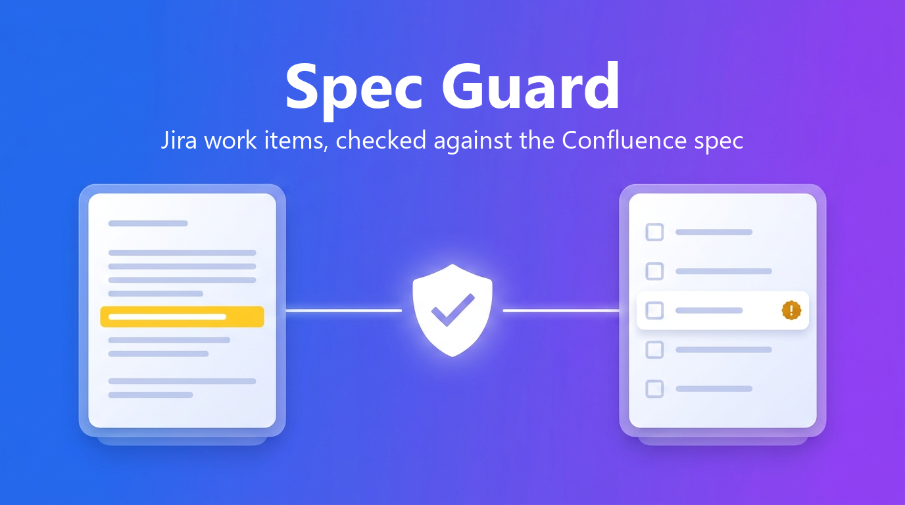

# Spec Guard



Spec Guard checks Jira work items against the Confluence page that specifies them, tells you where they disagree, and keeps them in step when either side changes. Coding agents can use the same checks through MCP, before and after they write code.

Built on Atlassian Forge for Codegeist 2026.

## Why

A requirement changes in Confluence ("the reset link expires after 24 hours"). The Jira work item still says 48. Whoever implements the work item, a developer or an AI agent, builds 48. The mismatch shows up in review, in QA or in production.

Spec Guard treats the spec as the source of truth and checks everything downstream against it.

## Features

**On a Jira work item**
- **Alignment report.** Spec Guard reads the linked spec, decides which requirements this work item is responsible for, and marks each one as covered, missing, conflicting, unclear, or delivered by another work item. Every finding quotes the spec and the work item, and every quote is checked against its source. Quotes not found word for word are flagged. Single words or numbers do not count as verified, a quote shortened with "..." only counts if each piece is at least 10 characters long and the pieces are close together, and a conflict whose spec quote cannot be found is shown as "unclear" and not counted.
- **Align work item with spec.** Proposes acceptance criteria with the spec's values. You review the changes, then apply them. Only the acceptance criteria section of the description is replaced, and a comment records what changed.
- **Verify a change.** Paste a summary or diff of what was implemented. The verdict (pass, needs attention, fails spec) judges the change only; problems in the work item itself are listed separately.
- **Sidebar status** on every work item, and automatic re-check when the description is edited.
- **Not a spec?** If a work item links several Confluence pages, switch off the ones that are not specifications.

**On a Confluence spec page**
- The work items that implement the spec and which of them drift.
- **Requirement coverage map:** each requirement, the work items that deliver it, conflicts between them, and gaps that no work item covers. One click creates work items for the gaps (linked to the spec and quoting the requirement; a gap that already has a work item is skipped, matched by the requirement's text).

**When the spec changes**
- Each affected work item gets a comment saying the spec changed and how many changes affect it, and its report is marked out of date. The before/after details are shown in Spec Guard only to people who can read the spec.

**Across the site**
- A Jira page listing every checked work item, conflicts first.
- JQL: `specGuardConflicts > 0`, `specGuardMissing > 0`, `specGuardScore < 60`, `specGuardSpecChanged = 1`.
- **Try with demo data** creates a spec page and three work items that drift from it, so the app can be tried on an empty site.

**For agents**
- A **Rovo agent** ("Is this work item aligned with its spec?", "Which requirements are not covered?", "Fix this work item").
- The same capabilities as **MCP tools** for Claude Code, Cursor and other MCP clients:

| Tool | Use |
|---|---|
| `get-spec-context` | Before coding: the work item, the full spec text and the latest analysis |
| `verify-change` | After coding: check a summary or diff against the spec |
| `check-alignment`, `get-alignment-status` | Full check, or the saved result |
| `get-spec-coverage` | Coverage map of a spec |
| `align-work-item` → `apply-alignment` | Propose corrected acceptance criteria; apply only after the user approves |
| `create-gap-work-items` | Create work items for uncovered requirements |
| `get-job-result` | Collect a result that took longer than ~18 seconds |

## How it works

- Forge UI Kit: issue panel, issue context, global page, Confluence byline.
- Forge LLM (Claude hosted by Atlassian). No data leaves Atlassian; the app is eligible for Runs on Atlassian.
- Rovo agent and actions; the same actions are exposed with `rovo:mcp`.
- LLM work runs on a Forge events queue. Background jobs use offline user impersonation, so each job runs with the permissions of the user who started it.
- Forge KVS stores analyses, spec snapshots (for before/after diffs) and the spec-to-work-item index (one key per link).
- Triggers: Confluence page updated, Jira work item created or updated, and an hourly check that catches spec changes if an event is missed.
- Work items linked to a spec are found from the link index and by scanning recently updated work items in the same projects.

### Permissions and safety
Who each request runs as:

| What | Runs as |
|---|---|
| Panels, byline, global page, Rovo and MCP actions | The current user |
| Background jobs started by a user (check, verify, coverage, align) | That user (offline impersonation) |
| Re-check after a description edit | The editor, and only if they can read every spec page of the saved report; otherwise the report is just marked out of date |
| Reacting to a spec change (event or hourly check) | Reads the page as the editor or as the user who last analysed it; reads the linked work items and posts the notice comment as the app |
| JQL issue property | Written by the app |

- Analyses, coverage maps and before/after diffs contain spec text. They are only returned to users who can read every spec page they are based on; spec changes from a page the viewer cannot read are left out, and coverage notes that mention work items the viewer cannot see are dropped.
- Comments written to Jira never contain spec text.
- Spec and work item text is passed to the model inside data tags, and the model is told not to follow instructions in it.
- Agent actions refuse to run when the calling user cannot be identified, so they never fall back to the app's permissions.
- Changes to work item content need a user action: aligning a work item is propose, then apply (single use, same user, 24 hours, refused if the work item changed in between). Creating gap work items from an agent is two calls: the first returns a preview and a `previewId`, the second creates exactly the previewed set, only for the same user and only if the coverage map has not changed. Automatic writes are limited to the spec-change comment, the JQL property and refreshed reports.
- Each user can start up to 60 checks, verifications and coverage maps per hour, and one that is already running is not started twice. The *Check specs for changes* button can be used once every 10 minutes per site.
- Switching a linked page off ("not a spec") needs edit permission on the work item.

## Evaluation

See [docs/EVALUATION.md](docs/EVALUATION.md): a seeded spec with known conflicts, analysed repeatedly, with detection rate, false positives, run-to-run stability and quote verification.

## Install

1. Open the **[installation link](https://developer.atlassian.com/console/install/00236d0b-a8f0-4b50-82c2-f1d2d34642cc?signature=AYABeANXnkRj8HTUktLBcipDCiMAAAADAAdhd3Mta21zAEthcm46YXdzOmttczp1cy13ZXN0LTI6NzA5NTg3ODM1MjQzOmtleS83MDVlZDY3MC1mNTdjLTQxYjUtOWY5Yi1lM2YyZGNjMTQ2ZTcAuAECAQB4CxqLTo9l4lqXuFjNim1xJM%2Bp%2F3TVP9xHS2BrU5DRRucB5R7YMDOdYQ2qI8zw%2BemziAAAAH4wfAYJKoZIhvcNAQcGoG8wbQIBADBoBgkqhkiG9w0BBwEwHgYJYIZIAWUDBAEuMBEEDIfsHqTrZqFxohTPugIBEIA7bizlk2Qdd0QT%2BV1mWdRnlwi2XODKze6VP7WW2FxGnY47pQcZarof5zdfwBXbv1wJfCZQRU8n5o85GQYAB2F3cy1rbXMAS2Fybjphd3M6a21zOmV1LXdlc3QtMTo3MDk1ODc4MzUyNDM6a2V5LzQ2MzBjZTZiLTAwYzMtNGRlMi04NzdiLTYyN2UyMDYwZTVjYwC4AQICAHi9bVMAkme4qVQX1fQHo6ePw3H40A7cGfz7yrmSfBWMXgFLc99DspU4OhiaWHU6POCdAAAAfjB8BgkqhkiG9w0BBwagbzBtAgEAMGgGCSqGSIb3DQEHATAeBglghkgBZQMEAS4wEQQMt0HI%2BPj7h2Vw6v3EAgEQgDuryNSL7I8e6qig9heuqBYzRJ0dl9IkJTGTQgr4ZUqpykeIApCgkb%2B3Vfvkkp4ZjfzrECmXWRHp9v7M%2FQAHYXdzLWttcwBLYXJuOmF3czprbXM6dXMtZWFzdC0xOjcwOTU4NzgzNTI0MzprZXkvNmMxMjBiYTAtNGNkNS00OTg1LWI4MmUtNDBhMDQ5NTJjYzU3ALgBAgIAeDYASx0XCjkny4iLV6vz%2BKtEGSGT6kdt0QRpkn6D%2FlVEASJNilwFMGMO8xJXG3kf%2B5EAAAB%2BMHwGCSqGSIb3DQEHBqBvMG0CAQAwaAYJKoZIhvcNAQcBMB4GCWCGSAFlAwQBLjARBAyMypGgeVX9Ft8XNs0CARCAO7JMtclSUtw5VQdZRIuetcDvbAI1rjjrEJGPGMs2h0GooMXWEjSWRBC86NP%2FK%2BDyMkhbrdT2V5Z0MY%2BdAgAAAAAMAAAQAAAAAAAAAAAAAAAAACvZFdow3E1JwxQ6vTpoIS3%2F%2F%2F%2F%2FAAAAAQAAAAAAAAAAAAAAAQAAADIKPmz3jAqCHdRqw83sRUGfZI5zE6O7idEUKNLBh7NjpzO7%2FSSrUDyzkoxaN%2FmMVMjgASJCBBzU3WWcy9exyDVJsgM%3D&product=jira&product=confluence)** and install into a site with Jira first, then Confluence.
2. In Jira, open **Apps → Spec Guard** → *Try with demo data*, pick a Jira space and a Confluence space, and click **Create demo scenario**. Or paste a Confluence page URL into any work item's description.
3. Open the first demo work item and click **Check alignment** in the Spec Guard section of the details sidebar. The full report is under the **Apps** button next to the work item title → Spec Guard.

**Rovo and MCP** need a site with Rovo (free developer sites do not have it; `forge site provision` creates a demo site that does). For MCP:
1. Atlassian Administration → Apps → Sites → *your site* → Connected apps → Spec Guard → **Enable tools**.
2. `claude mcp add --transport http spec-guard https://mcp.atlassian.com/forge/00236d0b-a8f0-4b50-82c2-f1d2d34642cc`, then `/mcp` in Claude Code to sign in.

### Troubleshooting
- **MCP returns "not allowed to expose its tools"** on a site where the app is connected to both Jira and Confluence: this is a known Forge issue (Nov 2026). Disconnect Confluence, click Disable tools and then Enable tools, and connect Confluence again.
- **No "spec changed" comment after editing a spec:** Confluence events can be delayed. The hourly check catches them, or click *Check specs for changes* on the Spec Guard page in Jira. The work item's Spec Guard section shows the change as soon as it is opened.

## Development

```bash
npm install
npm test                      # unit tests (text conversion, quote verification, scoring, coverage)
forge deploy -e development
forge install --site <site>.atlassian.net --product jira -e development
forge install --site <site>.atlassian.net --product confluence -e development
```

If the Forge CLI hangs on your network, `forge settings set usage-analytics false` stops it from contacting its telemetry endpoint.

## License

MIT
