<p align="center">
  
</p>

<p align="center">
  <b>Spec Guard keeps Jira work items, and the code agents write for them, in line with the Confluence spec.</b><br>
  Built on Atlassian Forge for Codegeist 2026.
</p>

<p align="center">
  
  
  
  
  
  
</p>

---

## The problem

A requirement changes in Confluence: the password reset link now expires after **24 hours**. The Jira work item still says **48**. Whoever implements the work item, a developer or a coding agent, builds 48. The mismatch shows up in review, in QA, or in production.

Coding agents make this more likely, because they build exactly what the work item says, quickly and confidently.

Spec Guard treats the spec as the source of truth and checks everything downstream against it.

## What it does

### 1. Checks a work item against its spec

Spec Guard reads the linked Confluence page, works out which requirements this work item is responsible for, and marks each one as covered, missing, conflicting, unclear, or delivered by another work item.

<table>
<tr>
<td width="62%">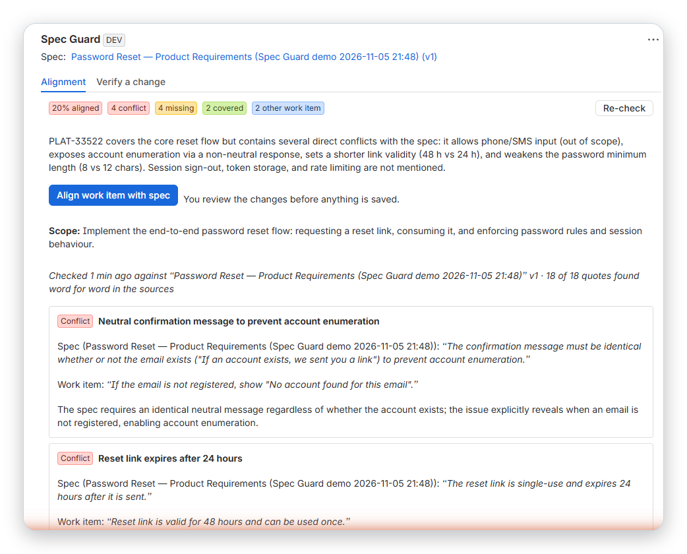</td>
<td>

- Every finding quotes **both** the spec and the work item.
- Every quote is checked against its source; quotes that are not found word for word are labelled, and a conflict whose spec quote cannot be found is not counted.
- Requirements owned by other work items are recognised, so they are not reported as missing.
- A compact status sits in the work item sidebar.

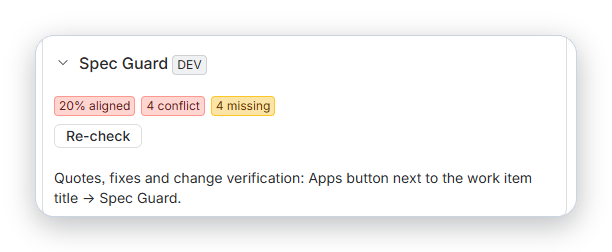

</td>
</tr>
</table>

### 2. Fixes the work item, after you approve

**Align work item with spec** proposes acceptance criteria with the spec's values. You review the changes, then apply them. Only the acceptance criteria section is replaced, a comment records what changed, and the work item is re-checked.

<table>
<tr>
<td width="50%">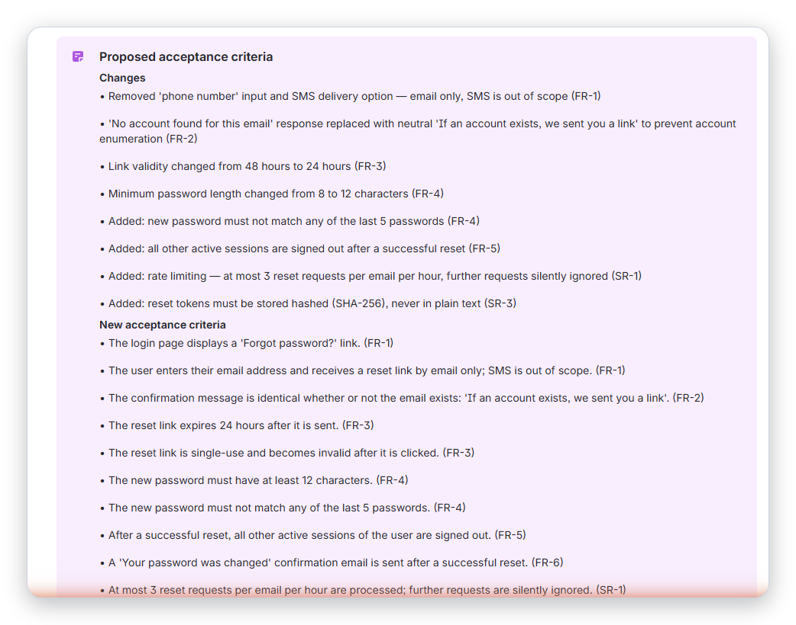</td>
<td width="50%">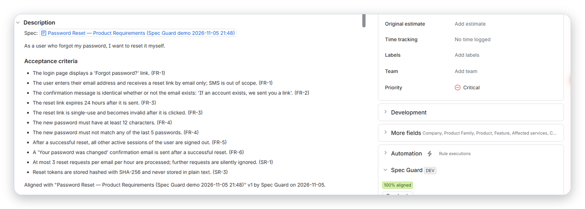</td>
</tr>
<tr><td align="center"><sub>The proposal lists every change</sub></td><td align="center"><sub>After applying: 20% → 100% aligned</sub></td></tr>
</table>

### 3. Maps requirement coverage on the spec page

From the Confluence byline: each requirement, the work items that deliver it, the work items that contradict it, and the requirements nobody is building. It also finds work items that link the spec but were never checked. One click creates linked work items for the gaps.

<table>
<tr>
<td width="58%">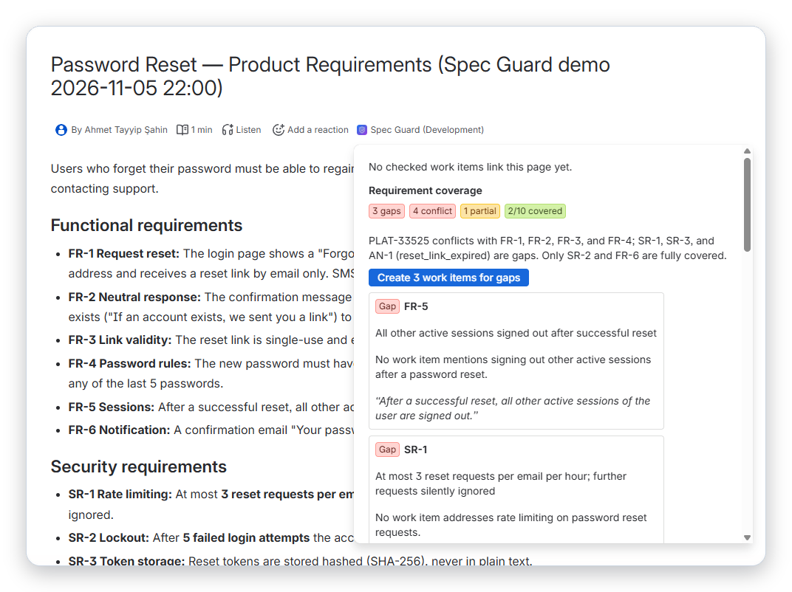</td>
<td>
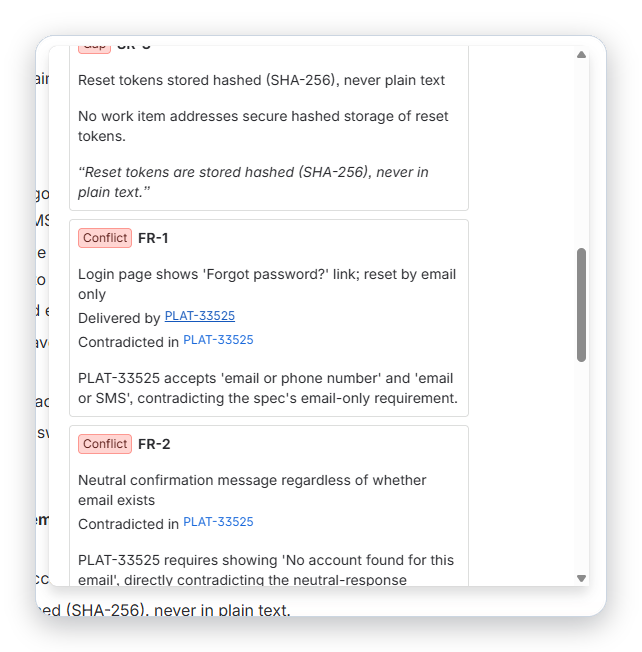<br>
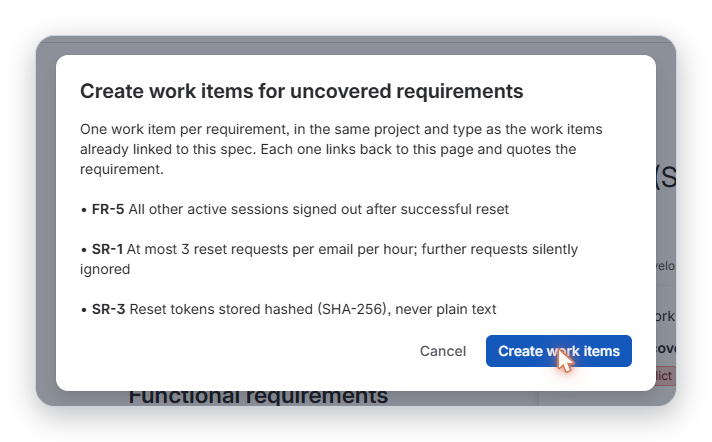
</td>
</tr>
</table>

### 4. Tells work items when the spec changes

When a spec page changes, each affected work item gets a short comment and its report is marked out of date, with the exact before and after. The before/after text is shown only to people who can read the spec; the automatic Jira comment never contains spec text.

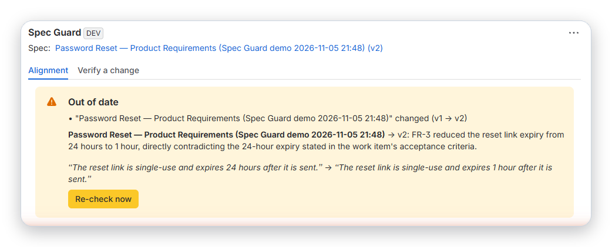
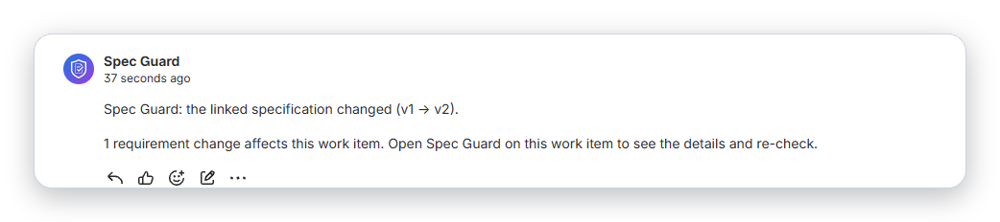

### 5. Makes drift visible across the site

A Jira page lists every checked work item, conflicts first, and the results are searchable with JQL: `specGuardConflicts > 0`, `specGuardMissing > 0`, `specGuardScore < 60`, `specGuardSpecChanged = 1`.

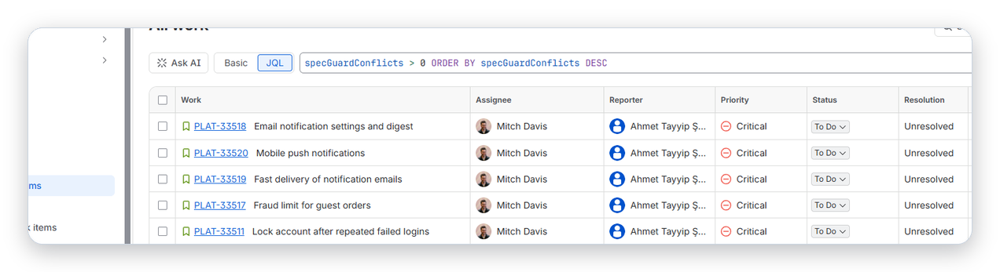

### 6. Gives coding agents the spec (MCP) and works in Rovo

The same capabilities are available as a **Rovo agent** and as **MCP tools** for Claude Code, Cursor and other MCP clients. An agent reads the spec before it writes code and checks its change afterwards.

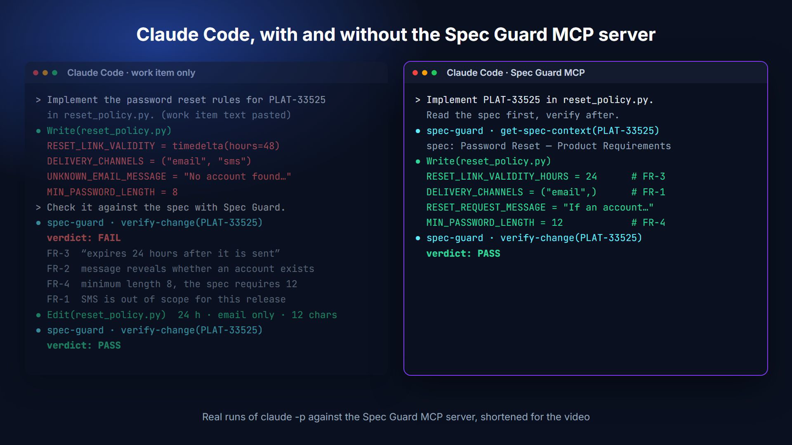

<sub>Real <code>claude -p</code> runs, shortened. Left: the agent builds from the work item (48 hours, SMS, 8 characters); <code>verify-change</code> fails it and quotes the spec; after the fix it passes. Right: with Spec Guard connected, the agent calls <code>get-spec-context</code> first and gets it right the first time.</sub>

<table>
<tr>
<td width="60%">

| Tool | Use |
|---|---|
| `get-spec-context` | Before coding: the work item, the full spec text and the latest analysis |
| `verify-change` | After coding: check a summary or diff against the spec |
| `check-alignment`, `get-alignment-status` | Full check, or the saved result |
| `get-spec-coverage` | Coverage map of a spec |
| `align-work-item` → `apply-alignment` | Propose corrected acceptance criteria; apply only after the user approves |
| `create-gap-work-items` | Preview first; create with the returned `previewId` after the user agrees |
| `get-job-result` | Collect a result that took longer than ~18 seconds |

</td>
<td>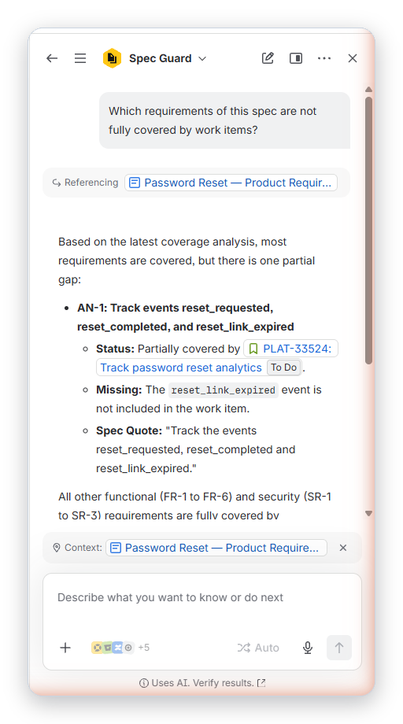</td>
</tr>
</table>

## How it works

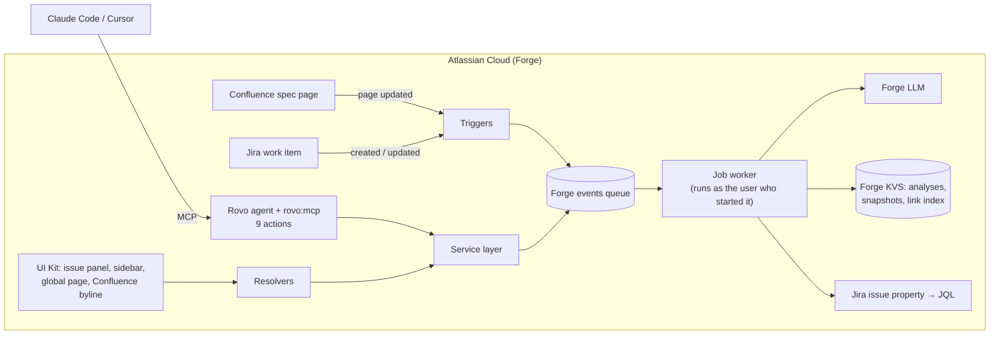

- **Forge UI Kit** for the Jira issue panel, issue sidebar, global page and Confluence byline.
- **Forge LLM** (Claude hosted by Atlassian). No data leaves Atlassian; the app is eligible for Runs on Atlassian.
- **Rovo agent** with nine actions, exposed to external agents with **`rovo:mcp`**.
- All LLM work runs on a **Forge events queue**. Background jobs use offline user impersonation, so each job runs with the permissions of the person who started it.
- **Forge KVS** stores analyses, spec snapshots (for before/after diffs) and a spec-to-work-item index; an **issue property** makes results searchable with JQL.
- **Triggers** for Confluence page updates and Jira work item changes, plus an hourly check in case an event is missed.

### Permissions and safety

| What | Runs as |
|---|---|
| Panels, byline, global page, Rovo and MCP actions | The current user |
| Background jobs started by a user (check, verify, coverage, align) | That user (offline impersonation) |
| Re-check after a description edit | The editor, only if they can read every spec page of the saved report; otherwise the report is just marked out of date |
| Reacting to a spec change (event or hourly check) | Reads the page as the editor or the user who last analysed it; reads linked work items and posts the notice comment as the app |
| JQL issue property | Written by the app |

- Analyses, coverage maps and before/after diffs contain spec text and are only returned to users who can read every spec page they are based on. Findings and notes about work items the viewer cannot see are hidden.
- The automatic spec-change comment never contains spec text. Text that a person chooses to write into Jira (applied acceptance criteria, gap work items) does quote the requirement, because that is its purpose.
- A conflict only counts when both its spec quote and its work item quote are found word for word; otherwise it is shown as unclear.
- Spec and work item text is passed to the model inside data tags, and the model is told not to follow instructions in it.
- Agent actions refuse to run when the calling user cannot be identified; they never fall back to the app's permissions.
- Changes to work item content need a person: aligning is propose, then apply (single use, same user, 24 hours, refused if the work item changed in between). Gap work items from an agent need a preview and a second call with its `previewId`.
- Each user can start up to 60 checks, verifications and coverage maps per hour; a job that is already running is not started twice.

## Evaluation

A small, repeatable smoke test with planted conflicts, run against the live app through the MCP endpoint. Details, raw results and limitations: [docs/EVALUATION.md](docs/EVALUATION.md).

| Measure | Run 1 | Run 2 |
|---|---|---|
| Planted conflicts found (4 conflicts × 3 runs) | 11 / 12 | 12 / 12 |
| False conflicts | 0 | 1 |
| False "missing" (owned by another work item) | 0 | 0 |
| Quotes found word for word | 107 / 107 | 105 / 105 |

A second set adds a 24-requirement PRD with tables and stale values in its revision history, a Turkish spec, and a spec that contains a prompt injection: **27 of 27** planted conflicts found across 15 runs, **0** false conflicts, every quote verified, and the injected instruction was not followed. This set also found a real bug (HTML entities in non-English specs), fixed before the final run.

## Install

1. Open the **[installation link][install]** and install into a site with Jira first, then Confluence.
2. In Jira, open **Apps → Spec Guard** → *Try with demo data*, pick a Jira space and a Confluence space, and click **Create demo scenario**. Or paste a Confluence page URL into any work item's description.
3. Open the first demo work item and click **Check alignment** in the Spec Guard section of the details sidebar. The full report is under the **Apps** button next to the work item title → Spec Guard.

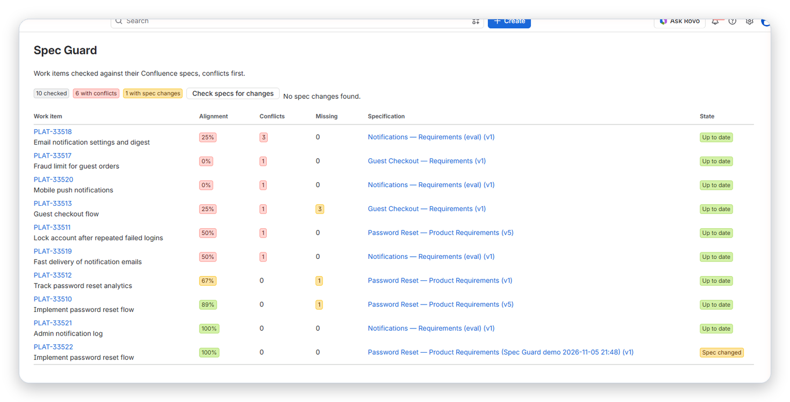

**Rovo and MCP** need a site with Rovo (free developer sites do not have it; `forge site provision` creates a demo site that does). For MCP:
1. Atlassian Administration → Apps → Sites → *your site* → Connected apps → Spec Guard → **Enable tools**.
2. `claude mcp add --transport http spec-guard https://mcp.atlassian.com/forge/00236d0b-a8f0-4b50-82c2-f1d2d34642cc`, then `/mcp` in Claude Code to sign in.

### Troubleshooting
- **MCP returns "not allowed to expose its tools"** on a site where the app is connected to both Jira and Confluence: a known Forge issue (Nov 2026). Disconnect Confluence, click Disable tools and then Enable tools, and connect Confluence again.
- **No "spec changed" comment after editing a spec:** Confluence events can be delayed. The hourly check catches them, or click *Check specs for changes* on the Spec Guard page in Jira.

## Development

```bash
npm install
npm test                      # unit and service tests (Forge modules mocked)
forge deploy -e development
forge install --site <site>.atlassian.net --product jira -e development
forge install --site <site>.atlassian.net --product confluence -e development
```

If the Forge CLI hangs on your network, `forge settings set usage-analytics false` stops it from contacting its telemetry endpoint.

## License

MIT

[install]: https://developer.atlassian.com/console/install/00236d0b-a8f0-4b50-82c2-f1d2d34642cc?signature=AYABeANXnkRj8HTUktLBcipDCiMAAAADAAdhd3Mta21zAEthcm46YXdzOmttczp1cy13ZXN0LTI6NzA5NTg3ODM1MjQzOmtleS83MDVlZDY3MC1mNTdjLTQxYjUtOWY5Yi1lM2YyZGNjMTQ2ZTcAuAECAQB4CxqLTo9l4lqXuFjNim1xJM%2Bp%2F3TVP9xHS2BrU5DRRucB5R7YMDOdYQ2qI8zw%2BemziAAAAH4wfAYJKoZIhvcNAQcGoG8wbQIBADBoBgkqhkiG9w0BBwEwHgYJYIZIAWUDBAEuMBEEDIfsHqTrZqFxohTPugIBEIA7bizlk2Qdd0QT%2BV1mWdRnlwi2XODKze6VP7WW2FxGnY47pQcZarof5zdfwBXbv1wJfCZQRU8n5o85GQYAB2F3cy1rbXMAS2Fybjphd3M6a21zOmV1LXdlc3QtMTo3MDk1ODc4MzUyNDM6a2V5LzQ2MzBjZTZiLTAwYzMtNGRlMi04NzdiLTYyN2UyMDYwZTVjYwC4AQICAHi9bVMAkme4qVQX1fQHo6ePw3H40A7cGfz7yrmSfBWMXgFLc99DspU4OhiaWHU6POCdAAAAfjB8BgkqhkiG9w0BBwagbzBtAgEAMGgGCSqGSIb3DQEHATAeBglghkgBZQMEAS4wEQQMt0HI%2BPj7h2Vw6v3EAgEQgDuryNSL7I8e6qig9heuqBYzRJ0dl9IkJTGTQgr4ZUqpykeIApCgkb%2B3Vfvkkp4ZjfzrECmXWRHp9v7M%2FQAHYXdzLWttcwBLYXJuOmF3czprbXM6dXMtZWFzdC0xOjcwOTU4NzgzNTI0MzprZXkvNmMxMjBiYTAtNGNkNS00OTg1LWI4MmUtNDBhMDQ5NTJjYzU3ALgBAgIAeDYASx0XCjkny4iLV6vz%2BKtEGSGT6kdt0QRpkn6D%2FlVEASJNilwFMGMO8xJXG3kf%2B5EAAAB%2BMHwGCSqGSIb3DQEHBqBvMG0CAQAwaAYJKoZIhvcNAQcBMB4GCWCGSAFlAwQBLjARBAyMypGgeVX9Ft8XNs0CARCAO7JMtclSUtw5VQdZRIuetcDvbAI1rjjrEJGPGMs2h0GooMXWEjSWRBC86NP%2FK%2BDyMkhbrdT2V5Z0MY%2BdAgAAAAAMAAAQAAAAAAAAAAAAAAAAACvZFdow3E1JwxQ6vTpoIS3%2F%2F%2F%2F%2FAAAAAQAAAAAAAAAAAAAAAQAAADIKPmz3jAqCHdRqw83sRUGfZI5zE6O7idEUKNLBh7NjpzO7%2FSSrUDyzkoxaN%2FmMVMjgASJCBBzU3WWcy9exyDVJsgM%3D&product=jira&product=confluence
